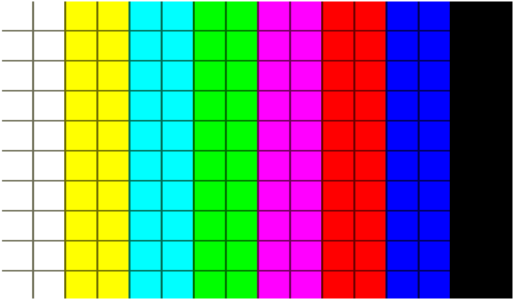

Video Pipeline
==============

The video pipeline is a Hazard3-Doom/ULX3S SoC feature around the processor; it
is not part of the upstream Hazard3 CPU core. The CPU produces framebuffer data
with ordinary memory operations, while project hardware turns that data into a
display signal.

Doom keeps its native indexed renderer. The project does not require the game to render a full RGB framebuffer in software.

Pipeline
--------

#. Doom renders a 320x200 8-bit indexed frame into the project screen buffer.
#. Software writes the completed indexed frame into the inactive internal EBR
   framebuffer through the direct video register path.
#. The internal frame buffers swap on vertical blank.
#. A hardware palette converts the indexed pixels for HDMI scanout.

The output raster depends on the board: ULX3S 85F currently uses
640x480 at 25 MHz pixel / 125 MHz TMDS, while ULX3S 12F and ULX4M-LD
use 1024x600 at 50 MHz pixel / 250 MHz TMDS. ULX5M-GS is headless in the
current sweep. The ``hdmi_output_resolution`` workflow dropdown and local
``SWEEP_HDMI_OUTPUT_RESOLUTION`` setting accept only the existing board
resolution; they do not reprogram the physical raster. The separate
``HAZARD3_HDMI_EXTENDED_MODES`` option controls framebuffer capability.

Output geometry
---------------

The documented 1024x600 output scales Doom's native 320x200 indexed frame to the full panel. Vertical scaling is exactly 3x (200 to 600 lines), while horizontal scaling is fractional so all 1024 output pixels are used.

Why indexed color?
------------------

Keeping the native indexed representation reduces software memory traffic and allows palette conversion to occur in dedicated FPGA logic.

Video registers
---------------

The HDMI/video control register block begins at:

.. code-block:: text

   0x4000C000

Web Serial screen snip path
---------------------------

The Web Serial screenshot feature is intentionally above the physical HDMI
encoder. It does not capture TMDS and does not depend on a general-purpose EBR
readback path. A supported active application serializes its indexed source
frame plus the RGB332 palette over UART using the ``H3SNIP1`` protocol. The
browser then reconstructs the advertised ``1024x600`` raster with
nearest-neighbor source mapping and encodes the PNG locally.

This keeps the wire payload compact relative to a full RGB framebuffer and lets
the same browser parser accept Doom sources and I2C GUI sources with different
geometries. See :doc:`../user-guide/web-serial` for the complete protocol.

Video test pattern
------------------

The monitor can generate a deterministic color-bar pattern when validating the
HDMI path independently of Doom rendering:

.. _fig-hdmi-colorbar-test-pattern:

   **HDMI color-bar test pattern** - a simple visual check that timing, scaling,
   palette conversion, and the physical display path are alive.

Non-Doom users of the video path
--------------------------------

The resident monitor can also use the direct indexed EBR path for diagnostics.
The :doc:`../user-guide/i2cdriver` interface renders its own 320x200 indexed
screen, writes the inactive internal framebuffer, and requests a vertical-blank
swap without modifying DoomGeneric.
