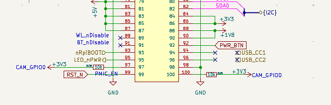
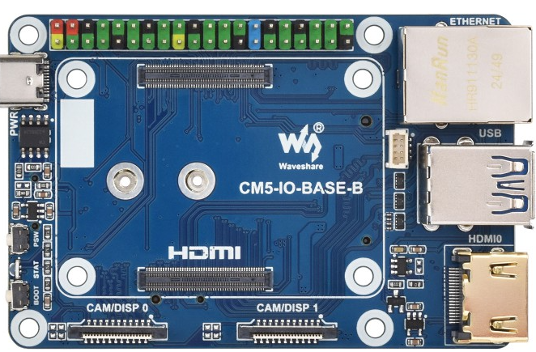
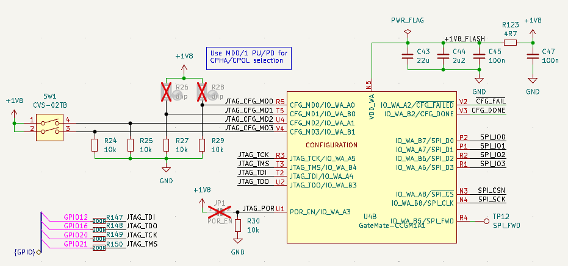
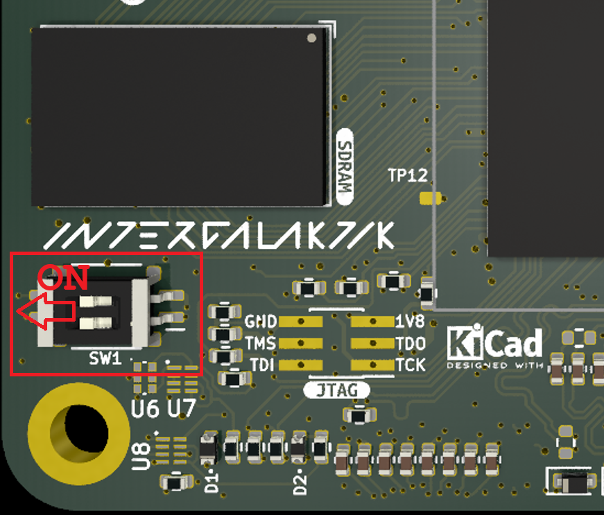

ULX5M-GS V005 Hardware Notes
============================

These notes describe the Intergalaktik ULX5M-GS V005 with the Cologne Chip
GateMate CCGM1A1. They record the electrical constraints and hardware
observations relevant to the in-development Hazard3-Doom port. They are not a
substitute for the board schematic or the FPGA datasheet. Check the populated
board revision before applying them to another unit.

.. warning:: East-bank voltage exceeds the GateMate rating

   The ULX5M-GS board manufacturer verbally confirmed that the USB-powered
   V005 board under investigation uses **3.3 V on GateMate bank EA**. This is
   a reported board configuration, not an independently measured VDD_EA
   reading or an endorsement by the FPGA manufacturer.

   Cologne Chip DS1001 (September 2026), Table 4.5, specifies **2.7 V**
   maximum operating VDDIO for single-ended GPIO. Table 4.1 specifies
   **2.75 V** absolute maximum VDDIO. Thus a 3.3 V VDD_EA supply exceeds both limits.
   Successful GPIO or USB operation does not establish that this supply is
   within specification, nor does a board-maker expectation that it will work
   override the FPGA ratings. Reliability and lifetime at 3.3 V are not
   qualified here.

   Do not connect additional 3.3 V drivers on the assumption that the FPGA is
   3.3 V tolerant. Do not change the board's rail straps or regulator settings
   without reviewing the V005 schematic and every peripheral attached to EA.
   A signal-level shifter alone cannot fix an out-of-range **VDD_EA supply**.

GPIO stress-test research
-------------------------

The external `gm_gpio_ringosc project
<https://github.com/pu-cc/gm_gpio_ringosc>`_ investigates operation of
GateMate 2.5 V-rated GPIO under 3.3 V stress. It uses GPIO ring oscillators
and reference measurements to look for changes in behavior; the authors warn
that the tests can permanently damage GPIO. This is **experimental stress
testing**, not qualification, a datasheet revision, or a demonstration of
long-term reliability at 3.3 V. It does not supersede DS1001 voltage limits.
Do not repeat overvoltage experiments on a board that must remain reliable.

GPIO voltage domains and evidence
---------------------------------

Do not assume that every ULX5M GPIO bank has the same supply. The board
repository's README says its default GPIO voltage is 1.8 V, but that general
statement does not establish the voltage of each bank on the specific V005
board being tested.

.. list-table:: ULX5M-GS V005 voltage observations (October 2026)
   :header-rows: 1
   :widths: 16 16 38 30

   * - Rail or interface
     - Reported level
     - Evidence
     - Qualification
   * - ``VDD_EA`` (east bank EA)
     - 3.3 V
     - Verbal confirmation from board manufacturer for the USB-powered board
     - Not yet independently measured at a VDD_EA supply point; exceeds DS1001
   * - ``VDD_EB`` (east bank EB)
     - About 1.8 V
     - Bench multimeter reading reported for the tested board
     - A separate rail from EA; do not extrapolate to every unit
   * - ``VDD_WA`` (configuration/JTAG bank)
     - 1.8 V in V005 schematic
     - V005 JTAG schematic shows ``VDD_WA`` on ``+1V8``; JTAG mode pins were
       also observed near 1.8 V
     - Tigard JTAG used 1.8 V logic; not a direct measurement of the supply ball
   * - Remaining GPIO banks
     - Not established here
     - Check board-revision schematics and populated regulators
     - Do not infer 1.8 V or 3.3 V from connector labels

The DS1001 single-ended input specification is ``-0.4 V`` to
``VDDIO + 0.4 V`` (Table 4.5). On a 1.8 V bank, direct 3.3 V inputs are outside
that range. Check the actual supply and use an appropriate interface before
connecting external logic. For 3.3 V peripherals, consult Cologne Chip's
UG1003 level-shifting guide; its examples assume the GateMate supply itself
is within its specified range.

USB-C power on the CM5-IO-BASE-B carrier
----------------------------------------

A reported ULX5M-GS V005 setup using a Waveshare CM5-IO-BASE-B carrier
showed no power LEDs when the carrier's USB-C input was connected to a
USB-C host or USB-C power adapter. A replacement carrier behaved the same
way. Connecting USB-C power directly to the FPGA board did illuminate its
LEDs. This is consistent with missing USB-C sink identification resistors,
not necessarily two defective carriers.

A USB-C sink normally advertises its presence using a nominal **5.1 kohm
pull-down (Rd) from each CC pin to ground**. The source detects Rd before
applying the initial 5 V VBUS supply. This attach detection is distinct from
USB Power Delivery negotiation for higher voltages or currents.

The CM5-IO-BASE-B USB-C schematic shows positions ``R4`` and ``R9``
marked ``NC`` (not populated), corresponding to the connector's CC lines.
The ULX5M V005 carrier interface drawing separately exposes ``USB_CC1``
and ``USB_CC2``. Verify the assembled revision and the actual CC circuit
rather than assuming that the FPGA or carrier provides the required Rd
terminations.

   CM5-IO-BASE-B Type-C power input schematic: CC resistor positions
   ``R4`` and ``R9`` are marked ``NC``.

   ULX5M V005 interface excerpt showing ``USB_CC1`` and ``USB_CC2``.
   These signal names alone do not establish that Rd is installed.

   Waveshare CM5-IO-BASE-B carrier board and USB-C power connector.

Possible remedies include using a suitable powered USB-A host or hub with
a USB-A-to-USB-C cable for **5 V-only power**, inserting a purpose-built
USB-C CC resistor adapter (for example `Adafruit product 6323
<https://www.adafruit.com/product/6323>`_), or installing the appropriate
5.1 kohm Rd resistors after checking the schematic and assembly. The adapter
must be intended for this particular sink-power use; avoid combining
unknown USB-C adapters or adding duplicate CC pull-downs. A USB-A workaround
does not provide USB Power Delivery and must supply sufficient current for
the board. Do not bypass current limits or inject an unverified voltage.

**Diagnostic check:** With power disconnected, inspect the CC terminations.
Then use a known-good, appropriately rated 5 V power source and measure VBUS
to GND at a documented safe test point. Do not infer a successful repair from
LEDs alone. This power problem is independent of USB enumeration and the
experimental SERV endpoint-zero data-path diagnostics below.

See :doc:`../../troubleshooting` for the symptom-oriented checklist.

USB-C connection
----------------

The experimental USB device implementation uses these EA pins:

.. list-table:: USB pins used by the ULX5M-GS port
   :header-rows: 1
   :widths: 24 26 50

   * - Function
     - GateMate signal
     - Note
   * - USB D+
     - ``IO_EA_A1``
     - EA supply reported as 3.3 V; do not infer the exact D+ line voltage
   * - USB D-
     - ``IO_EA_B1``
     - Shares bank EA and its VDDIO
   * - USB attach control
     - ``IO_EA_A2``
     - Controls the attach pull-up in the current USB probe

The board's 25 MHz oscillator is the reference for the experimental USB PLL.
One earlier probe produced approximately 47.9167 MHz for a nominal 48 MHz USB
clock. The PLL configuration, routed Fmax, USB clock accuracy, and signal
integrity are separate issues: a timing PASS does not prove USB signaling
compliance or reliable enumeration.

In October 2026, a JTAG/SRAM-loaded USB probe enumerated on Windows. Later
SERV-based endpoint-zero work also enumerated, but repeated USB descriptor
requests could intermittently fail after prior successful requests. The cause
has not been isolated to the SERV core, USB RTL, timing, or hardware voltages.
Do not present intermittent USB transactions as evidence that 3.3 V VDD_EA is
safe or that it caused the failures. See :doc:`../../user-guide/bootloader`
for the earlier hardware-tested probe and its limitations.

JTAG and configuration
----------------------

The V005 schematic routes the GateMate JTAG signals through the Raspberry Pi
40-pin header (GPIO12/16/20/21; header pins 32/36/38/40), with 200-ohm series
resistors. The configuration/JTAG bank is ``WA``, shown with a 1.8 V supply in
the schematic. The separately powered Tigard is configured for 1.8 V I/O;
leave Tigard ``VTGT`` disconnected and share GND with the board.

   V005 configuration/JTAG schematic excerpt. The ``VDD_WA`` rail is shown
   at ``+1V8``; ``JTAG_TCK``, ``JTAG_TMS``, ``JTAG_TDI``, and ``JTAG_TDO``
   are separate from the EA USB pins.

The board also has six front-side JTAG pads. Their mating connector has not
been positively identified; do not assume a standard 0.1-inch or SOP/SC70
footprint from photos alone. Verify the exact pad dimensions, pin order,
mechanical retention, and GND before soldering an adapter. See
:doc:`../../user-guide/bootloader` for the tested Tigard sequence and
:doc:`../../troubleshooting` for the required cold-start recovery procedure.

SW1 hardware boot selection (V005)
----------------------------------

SW1 is the two-position DIP switch in ``config.kicad_sch`` (sheet 5 of the
:download:`V005 schematic <../../ulx5m-gs.pdf>`). Its positions select the
GateMate configuration source at reset; they do not select the SERV firmware
mode. The bootloader RTL cannot change the power-on ``CFG_MD`` strap values.

SW1 connects ``+1V8`` to ``CFG_MD2`` (upper switch, pins 1-4) and ``CFG_MD3``
(lower switch, pins 2-3) when ON. ``R25`` and ``R24`` respectively pull these
signals to GND when OFF. ``CFG_MD0`` and ``CFG_MD1`` are fixed LOW through
``R27`` and ``R29``; optional pull-ups ``R26`` and ``R28`` are DNP. The tested
V005 board measured both ``CFG_MD2`` and ``CFG_MD3`` near 1.8 V with SW1 ON/ON.

.. list-table:: ULX5M-GS V005 SW1 configuration-mode settings
   :header-rows: 1
   :widths: 20 25 20 35

   * - SW1 upper / lower
     - ``CFG_MD[3:0]``
     - GateMate mode
     - Use
   * - ON / ON
     - ``1100`` (``0xC``)
     - JTAG
     - Tigard SRAM programming and JTAG-SPI flash access
   * - OFF / OFF
     - ``0000`` (``0x0``)
     - SPI active (mode 0)
     - Cold boot from the onboard AT25QL321 flash
   * - ON / OFF
     - ``0100`` (``0x4``)
     - SPI passive
     - Not used for autonomous flash boot
   * - OFF / ON
     - ``1000`` (``0x8``)
     - Unsupported
     - Do not select

   **ULX5M-GS SW1 Set to ON/ON**

Set both switches with FPGA power removed. Power-cycle the FPGA to sample
``CFG_MD[3:0]``; do not change SW1 while powered. ``BTN2`` is a separate,
latched **firmware** choice after the primary FPGA configuration loads:
hold BTN2 at startup for USB DFU, or leave it released for normal secondary
boot. BTN2 cannot recover an invalid primary configuration at flash offset
``0x000000``. Return SW1 to ON/ON and use Tigard/JTAG recovery if SPI-active
startup fails. This is a V005 schematic mapping; check other board revisions.

Cologne Chip DS1001, Table 3.1, defines ``0x0`` as SPI-active CPOL=0/CPHA=0
and ``0xC`` as JTAG. See :doc:`bringup` for the current SERV boot test status.

Configuration flash and development status
------------------------------------------

The tested board's SPI flash returned JEDEC ID ``1f 42 16`` (AT25QL321,
4 MiB). Two full factory backups were independently verified. On October 26,
2026 the SERV v50 seed-7 SPI-primary image was programmed into flash offset
``0x000000`` through the guarded v55 installer. Seven 64 KiB blocks and the
entire 4 MiB flash were verified after writing; the v41 secondary image at
``0x201000`` was preserved. That v55 test verified flash installation, not
secondary takeover. On October 28, an isolated v72c primary (not SERV/DFU)
was installed at ``0x000000..0x00ffff``. With SW1 OFF/OFF and BTN2 released,
its registered runtime configuration command successfully started the v41
walking-LED application at ``0x201000``. This is physical proof of SPI-active
secondary takeover, **not** qualification of a combined BTN2/DFU bootloader.
See :doc:`multiboot-v72` and :doc:`bringup`. Do not apply ULX4M flash layouts
or recovery commands to ULX5M.

The integrated **seed-160 SERV primary** has been verified
persistently from SPI flash in both BTN2-selected USB DFU and autonomous
secondary-boot modes. The normal path starts the walking-LED secondary at
``0x201000``; the DFU path enumerates ``1D50:614B`` and reads the installed
secondary back with a matching SHA-256. The experimental full-image ``FWTF``
primary also enumerated and verified the secondary while running from JTAG
SRAM, but its physical erase/program path remains **unqualified**. See
:doc:`serv-bootloader` for the current technical guide and safety limits.

Development notes and tested configurations
-------------------------------------------

The development record covers SERV DFU, flash backups, BTN2
selection, toolchain, timing and USB-port results. These are development
checkpoints. The older v72 secondary takeover experiment remains a useful
historical reference; the integrated seed-160 primary now passes both
persistent startup modes. Full-image USB flash writing is still experimental.

.. toctree::
   :maxdepth: 1

   serv-bootloader
   bringup
   multiboot-v72

Sources and revision checks
---------------------------

* `Intergalaktik ULX5M-GS hardware repository
  <https://github.com/intergalaktik/ulx5m-gs>`_ - V005 source, schematic and
  default-voltage statement.
* `Cologne Chip DS1001, GateMate FPGA datasheet
  <https://colognechip.com/docs/ds1001-gatemate1-datasheet-latest.pdf>`_ -
  September 2026; Tables 4.1 and 4.5 (supply and GPIO limits).
* `Cologne Chip UG1003, 3.3 V peripheral interface guide
  <https://www.colognechip.com/docs/ug1003-gatemate1-level-shifting-latest.pdf>`_
  - August 2025; Section 1 and the interfacing examples.

The file ``docs/ds1001-gatemate1-datasheet-latest.pdf`` in this repository
is a **January 2023** copy despite its filename. The limits quoted here were
rechecked against the manufacturer's **September 2026** DS1001. For current
ratings, follow the manufacturer's linked datasheet rather than relying on
that bundled copy being the latest revision.
