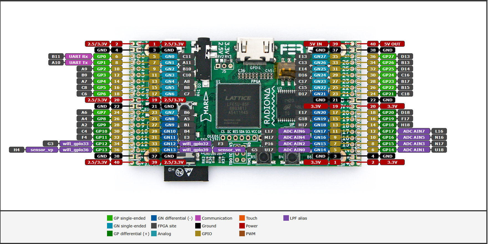
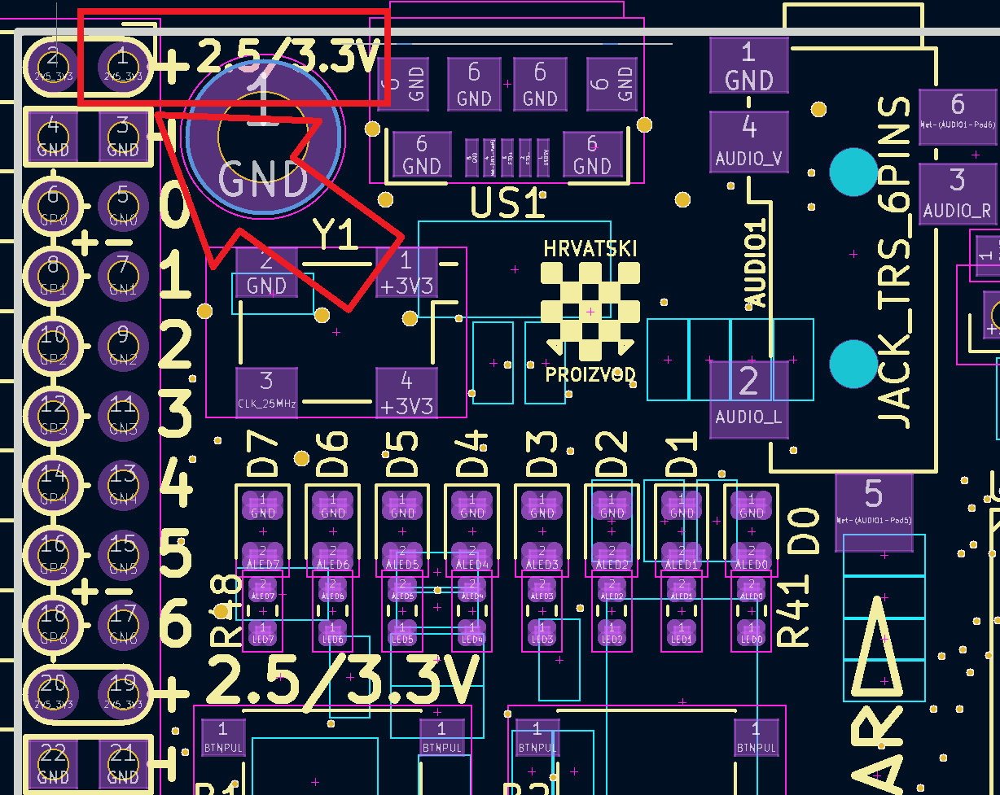

SAO / I2C Support
=================

Hazard3-Doom exposes a Hackaday-style SAO connector through an APB-controlled I2C/GPIO bridge. The same physical SAO bus can also be shared with the onboard ESP32 through an ownership sideband protocol.

Connector signals
-----------------

The Supercon SAO 2x3 pinout does not match the ULX3S J1 header layout. An adapter is required to connect the SAO signals correctly. Do not connect an SAO directly to J1.

The J1 I/O supply is configurable for 2.5V or 3.3V. Verify that the supply is configured for 3.3V before connecting an SAO that requires 3.3V power.

The ULX3S SAO signals are on ``J1`` (the 40 pin connector next to the ``F1`` button):

.. list-table::
   :header-rows: 1

   * - Signal
     - FPGA pin
     - Header GP/GN
     - J1 Row
     - Header Pin
   * - Power
     - 2.5/3.3V
     - 2.5/3.3V
     - Power
     - 1
   * - Ground
     - GND
     - GND
     - Ground
     - 3
   * - SCL
     - B10
     - GN2
     - 2
     - 9
   * - SDA
     - A9
     - GP2
     - 2
     - 10
   * - GPIO2
     - C10
     - GN3
     - 3
     - 11
   * - GPIO1
     - B9
     - GP3
     - 3
     - 12

   **ULX3S Pinout** - The SAO signals use J1 GPIO locations shown above. See
   :doc:`pinouts` for the general board-wiring reference.

Reminder: For the standard right-angled female J1/J2 headers, odd-numbered GPIO pins correspond to ``GN`` (-) signals, and even-numbered GPIO pins correspond to ``GP`` (+) signals, as indicated by the PCB silkscreen. These markings identify signal polarity within the GP/GN naming convention; they do not imply that all GPIO pins support differential signaling. J1 GP/GN 0-7 are single-ended signals.

Refer to the KiCad schematic for the ULX3S J1 pinout and the SAO connector pinout. The ULX3S J1 pin 1 indicator is shown below:

Hazard3 APB base
----------------

The SAO bridge is mapped at:

.. code-block:: text

   0x40009000

Monitor commands
----------------

The resident monitor provides commands including:

.. code-block:: text

   sao info
   sao gui
   sao recover
   sao scan
   sao probe
   sao read
   sao write
   i2c scan
   i2c gui

HDMI I2CDriver interface
------------------------

The resident monitor also provides an interactive I2CDriver-style HDMI tool:

.. code-block:: text

   i2c gui

The GUI provides scanning, probing, register reads/writes, bus recovery,
100/400-kHz selection, an address heatmap, transaction history, and a logical
SDA/SCL trace. See :doc:`i2cdriver` for controls, safety notes, and the
important distinction between an initiated logical trace and true passive bus
capture.

ESP32 sharing
-------------

The FPGA and ESP32 use the ULX3S Wi-Fi GPIO16/GPIO17 sideband connection to coordinate logical ownership of the SAO bus. The example ESP32 firmware lives under:

.. code-block:: text

   examples/esp32-sao-shared/

The owner that does not hold the bus must release its outputs rather than merely deciding not to transmit.

Electrical note
---------------

I2C pull-ups establish the idle high level but do not replace any series protection required by a particular SAO design. Review the electrical requirements of the add-on before attaching hardware that actively drives the optional GPIO lines.
